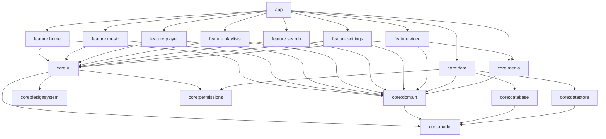
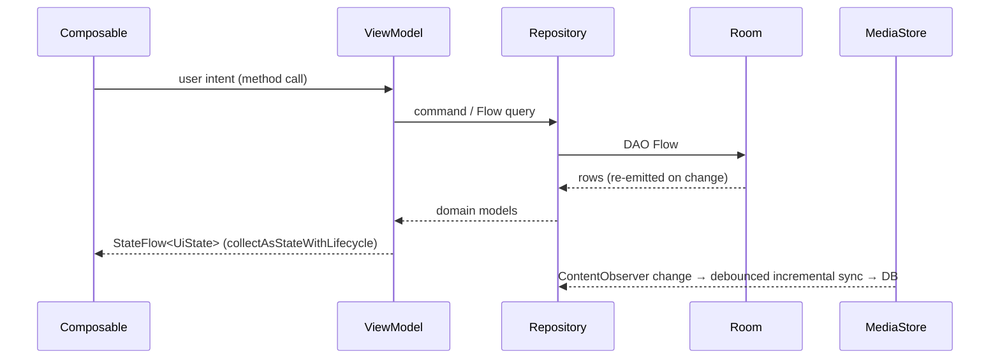
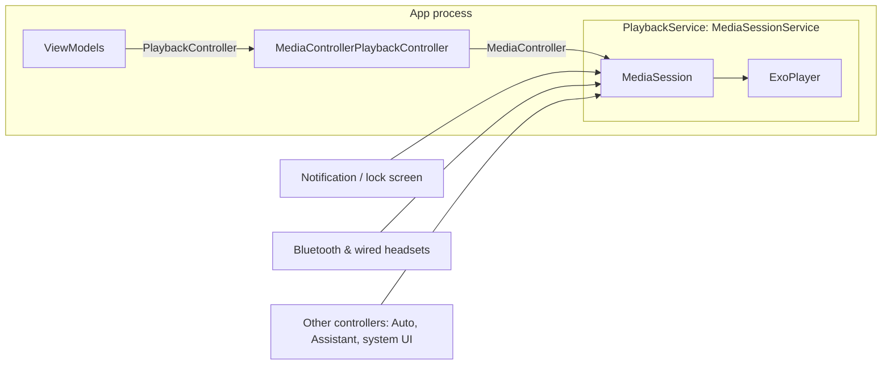

# Architecture

Resonance is a local-only audio and video player built with Clean Architecture, MVVM and
unidirectional data flow, split into Gradle modules along real dependency boundaries.

## Module graph

| Module | Kind | Responsibility |
|---|---|---|
| `core:model` | Kotlin/JVM | Immutable domain models (`MediaFile`, `PlaybackState`, `Playlist`, …). No Android. |
| `core:domain` | Kotlin/JVM | Repository contracts, the `PlaybackController` contract, use cases. No Android. |
| `core:common` | Android | Dispatchers, application scope, clock, structured logging, formatting. |
| `core:database` | Android | Room: entities, DAOs, FTS index, schema export, migrations. |
| `core:datastore` | Android | Preferences DataStore: user settings and sync bookkeeping. |
| `core:permissions` | Android | Which permissions to request per API level, and how grants map to access. Pure logic + a checker. |
| `core:data` | Android | Repository implementations, MediaStore source, library synchronisation. |
| `core:media` | Android | Media3: `PlaybackService`, the `MediaController` wrapper, video player factory. |
| `core:designsystem` | Compose | Theme (incl. dynamic colour), artwork loading, state components, fast scroll. |
| `core:ui` | Compose | Model-aware components: track rows and menus, collection header, permission UI, file picker. |
| `core:testing` | Android | Fakes for every repository and the controller, test data, rules, Hilt test runner. |
| `feature:*` | Compose | One screen family each: screens, ViewModels, navigation routes. |
| `app` | Application | Hilt entry point, navigation host, adaptive navigation bar/rail, mini player placement. |

### Dependency rules

- `core:model` and `core:domain` are plain Kotlin modules; the compiler enforces that business
  logic has no Android dependency.
- Features depend on `core:*` only, never on each other. Cross-feature navigation goes through
  lambdas supplied by `app` (`LibraryNavigator`, `onPlayVideo`, …).
- Features talk to playback only through the `PlaybackController` interface in `core:domain`. The
  one exception is `feature:video`, which uses `core:media`'s `VideoPlayerFactory` for its
  screen-scoped player.
- Repository implementations are `internal` bindings in `core:data` / `core:media`. Only `app`
  depends on those modules, so swapping an implementation touches no feature.
- Build configuration lives in `build-logic` convention plugins (`resonance.android.feature`,
  `resonance.android.room`, …), with versions in `gradle/libs.versions.toml`.

## Data flow

- ViewModels expose one immutable `StateFlow<UiState>` (`stateIn(WhileSubscribed(5s))`), often a
  sealed `Loading | Ready | …` type. Composables collect it with `collectAsStateWithLifecycle()`
  and send intents back as plain method calls.
- One-off events are modelled as state where possible: a deleted playlist becomes
  `PlaylistDetailUiState.Gone` and the screen pops itself. Playback failures, which are true
  events, use a `Channel` → `receiveAsFlow()` so each one is delivered once.
- Playback position is a separate, ticking `Flow<Long>`. It is not part of `PlaybackState`, so a
  position tick does not recompose every screen that reads the queue.

## The media library

MediaStore is the source of truth for which files exist. The `media` table is a local index that
makes queries fast (album, artist and genre aggregation, full-text search, sorting) and survives
process death.

`LibrarySynchronizer` keeps it in step:

- **Incremental** on Android 11+: only rows whose `GENERATION_MODIFIED` moved past the last-seen
  generation (per storage volume) are re-read. One cheap id-only query per kind detects deletions.
- **Full** on the first sync, below Android 11, when MediaStore's database was rebuilt
  (`MediaStore.getVersion` changed), when the granted access level changed, or on request.
  Partial video grants (Android 14 "selected videos") always re-read videos, because changing the
  selection does not move generations.
- **Safe to interrupt.** Generations are captured before querying. Changes commit in one Room
  transaction (one invalidation for observers). Bookkeeping is written only after the commit.
  Nothing is deleted unless every id listing finished.
- **Triggered** when the app comes to the foreground (`ProcessLifecycleOwner`), by debounced
  `ContentObserver` notifications while it stays there, by pull-to-refresh, and when access is
  granted.

Library preferences (minimum duration, include non-music audio, hide duplicates) are applied in
SQL by every audio query. Duplicates share a `duplicate_key` (title, artist, album, duration to
the second); the lowest MediaStore id of each group stays visible.

User data (playlists, favourites, history, video progress, the saved queue) has **no foreign key
to `media`**. An unmounted SD card or a mid-copy rescan must not cascade-delete playlists.
Queries inner-join `media`, so entries for missing files are hidden and reappear if the file
comes back.

Search uses an FTS4 table (`unicode61` tokenizer) over title, artist and album. Room keeps it
synced with triggers. User input is reduced to letters and digits and turned into prefix terms
(`daft pu` → `daft* pu*`), so typed operators can't change the MATCH syntax.

## Playback

**Ownership.** The audio `ExoPlayer` is created in `PlaybackService.onCreate` and released in
`onDestroy`. Nothing else creates or releases it, so recomposition and configuration changes
can't create a second player. Media3 promotes the service to the foreground while playing
(`foregroundServiceType="mediaPlayback"`) and handles audio focus, becoming-noisy (headphones
unplugged), media buttons, the notification and lock-screen controls. The default
`onTaskRemoved` stops the service when the app is swiped away while paused.

**Controller.** `MediaControllerPlaybackController` is the app's single `MediaController`
(process-wide, per Media3 guidance). Its connection follows the visible UI: `MainActivity.onStart`
connects and `onStop` disconnects, so the service isn't kept bound in the background. Commands
are fire-and-forget and go through one channel consumed on the main thread. That preserves their
order across the asynchronous connection handshake and keeps all `MediaController` access on its
required thread. A command issued while disconnected connects, runs, and releases again.

**Media items.** Each `MediaItem` carries its URI twice: in `localConfiguration` and in
`requestMetadata.mediaUri`. The session callback (`onAddMediaItems`) restores the URI for
controllers whose items lost `localConfiguration` crossing a process boundary. Ids are MediaStore
ids, or `uri:<document>` for files opened through the system picker.

**Session persistence.** The service saves the queue (library items only; picker documents lose
their URI grant), index, position, repeat, shuffle and speed to Room:

- debounced 500 ms after any queue, transition, play/pause, mode or seek event;
- every 15 s while playing, as a single-row position update (the queue table is rewritten only
  when the queue changed);
- on `onDestroy`, written on the application scope so the write outlives the service.

On start, when "Resume last session" is on and the player is empty, the queue is restored
**unprepared**: nothing decodes and no notification appears until the user presses play.
`onPlaybackResumption` serves the same data to system resumption (headset play button after a
reboot, the quick-settings media card). Restoring drops files that no longer exist; if the current
track is gone, playback resumes at the next surviving track from its start.

**Errors.** `onPlayerError` skips to the next item (unplayable, deleted or corrupt files) up to
five consecutive failures, then stops trying. The controller maps each `PlaybackException` to a
`PlaybackError` and emits it once. The app shell turns that into a snackbar naming the file.

**History.** One "play" is recorded each time an item starts, including each loop of repeat-one,
but not on pause/resume of the same item (`PlayHistoryTracker`). The table is capped at 5,000 rows.

**Video** uses a separate `ExoPlayer` owned by `VideoPlayerViewModel`. It survives rotation and
picture-in-picture (the activity handles those configuration changes itself) and is released in
`onCleared`. It requests audio focus as `AUDIO_CONTENT_TYPE_MOVIE`, which pauses music playback
automatically. Progress is saved on pause, every 10 s while playing, and on exit; positions under
5 s or within 10 s of the end are not kept. The player is its own activity (`singleTask`, separate
task affinity), so picture-in-picture shrinks only the video. It handles `ACTION_VIEW` for
`content://` videos from other apps.

## Permissions and privacy

| API level | Requested | Notes |
|---|---|---|
| 29–32 | `READ_EXTERNAL_STORAGE` (`maxSdkVersion=32`) | Covers audio and video. |
| 33 | `READ_MEDIA_AUDIO`, `READ_MEDIA_VIDEO` | Images are never requested. |
| 34+ | + `READ_MEDIA_VISUAL_USER_SELECTED` | "Selected videos only" is reported as partial access with a banner to change it. |

- Access is re-evaluated on every resume, because the user can revoke it in Settings at any time.
  When access is lost, the index is cleared so the app never shows files it can't read.
- The rationale is shown in context, in place of the library. After a permanent denial
  (`shouldShowRequestPermissionRationale` false after a denial), the button opens app settings.
- Without any permission, single files can still be played through the Storage Access Framework
  ("Open a file"), which grants access to that one document only.
- Notification permission is not requested: media-session notifications are exempt.
- The app has **no `INTERNET` permission**. ExoPlayer's `ACCESS_NETWORK_STATE` is removed in the
  manifest, and `android:allowBackup="false"` with data-extraction rules excluding everything,
  because MediaStore ids aren't portable between devices.
- Logs carry ids, counts and error codes only: never titles or paths (`core:common` `Log`).
  Release builds keep warnings and errors only and strip debug calls with R8.

## UI

- Material 3 with dynamic colour on Android 12+ and a teal brand scheme otherwise; light, dark or
  follow-system, chosen in Settings. The splash screen stays up until preferences load, so there
  is no theme flash.
- `NavigationSuiteScaffold` gives a bottom bar on phones and a navigation rail on wide and
  landscape windows. Each tab keeps its own back stack. The full-screen player hides both the
  navigation and the mini player.
- The now-playing screen switches to a side-by-side layout on wide windows. The video library is
  an adaptive grid.
- Artwork is loaded with Coil through a custom fetcher that asks MediaStore for a thumbnail at the
  drawn size. Full-resolution embedded art is never decoded for lists, and no network loader is
  installed.
- Accessibility: every icon button has a label. Rows are single click targets with roles. Switch
  rows are one toggleable node. Headings are marked. Sliders announce "elapsed / total". The
  queue and playlists reorder with explicit move up/down actions (usable by TalkBack and switch
  access); the letter fast-scroll is hidden from accessibility services, which have the list's
  own scroll actions.

## Decisions and trade-offs

| Decision | Why |
|---|---|
| minSdk 29 | Scoped storage, `RELATIVE_PATH`, `ContentResolver.loadThumbnail` and `MediaStore.getVersion` are all available, which removes a legacy code path for each. Covers the large majority of active devices. |
| compileSdk/targetSdk 37, AGP 9.4, Kotlin 2.4 | The current stable AndroidX releases (e.g. `core` 1.19) require compileSdk 37 and AGP ≥ 9.1. AGP 9's built-in Kotlin replaces the `kotlin-android` plugin. |
| Room index over live MediaStore queries | Aggregation, FTS and sorting across thousands of rows are fast, and screens open instantly from the index while sync runs in the background. |
| Sorting in Kotlin with `Collator` | Locale-correct alphabetical order (accents, case), which SQL `COLLATE NOCASE` doesn't give. |
| Fire-and-forget controller API | ViewModels and tests stay free of `ListenableFuture`. Ordering is guaranteed by the single command channel. |
| No FK from user data to `media` | Protects user data from transient storage changes, at the cost of keeping orphaned ids, which are hidden by joins. |
| Separate video player | Its lifetime is the screen's, not the service's. No video notification, and PiP doesn't need the session. |
| Kotlin warnings are errors | Deprecations surface immediately on upgrades. Override with `-Presonance.warningsAsErrors=false`. |
